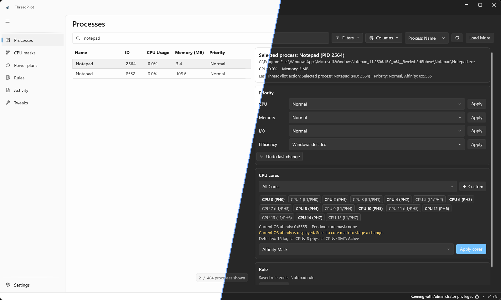
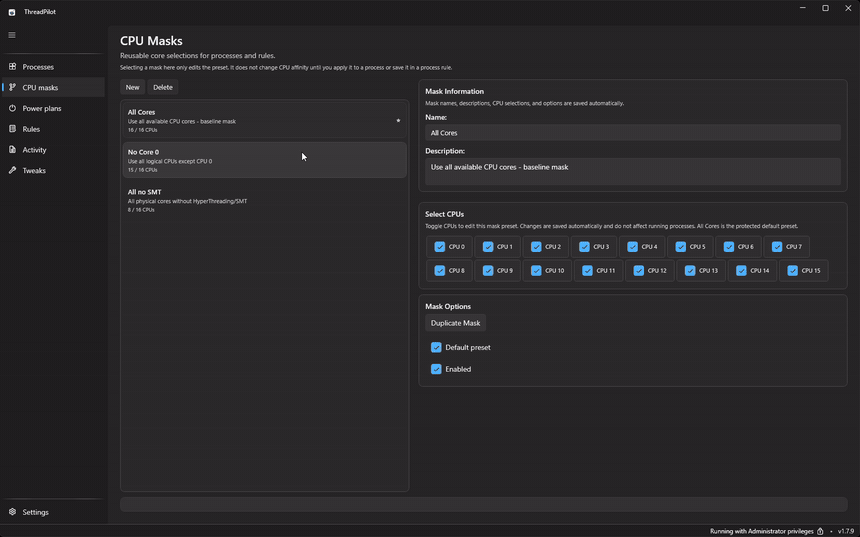
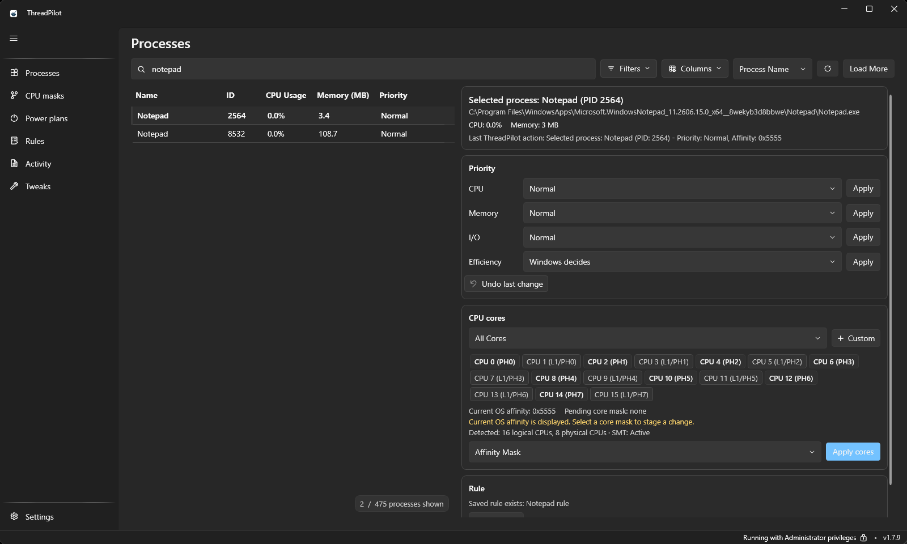
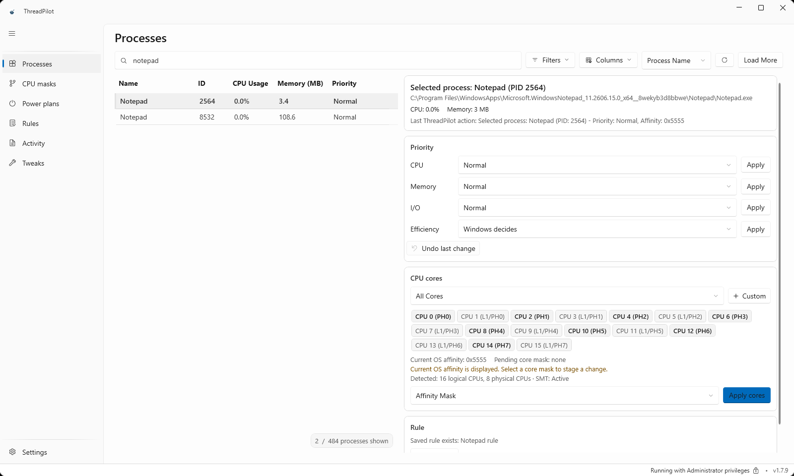
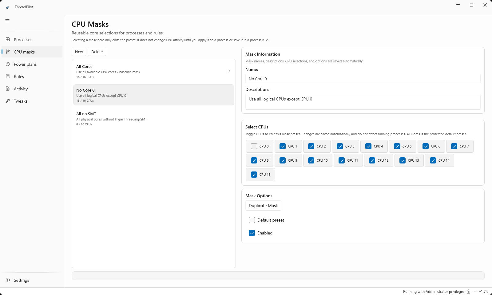
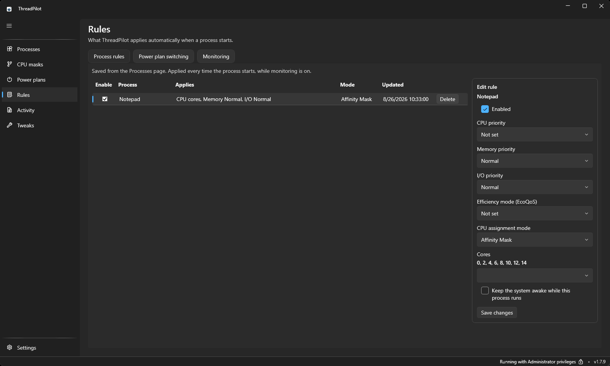
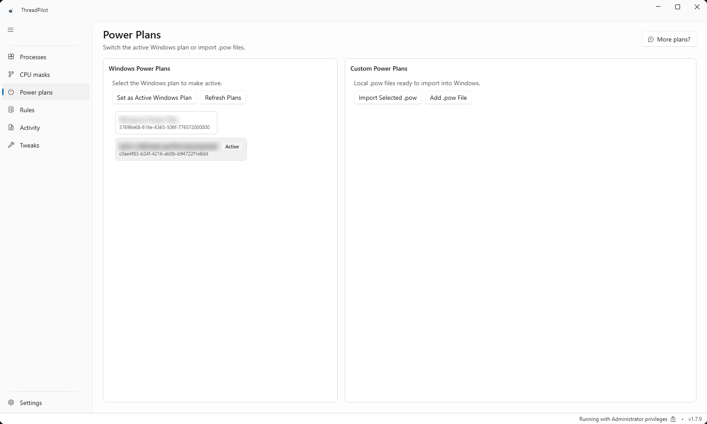
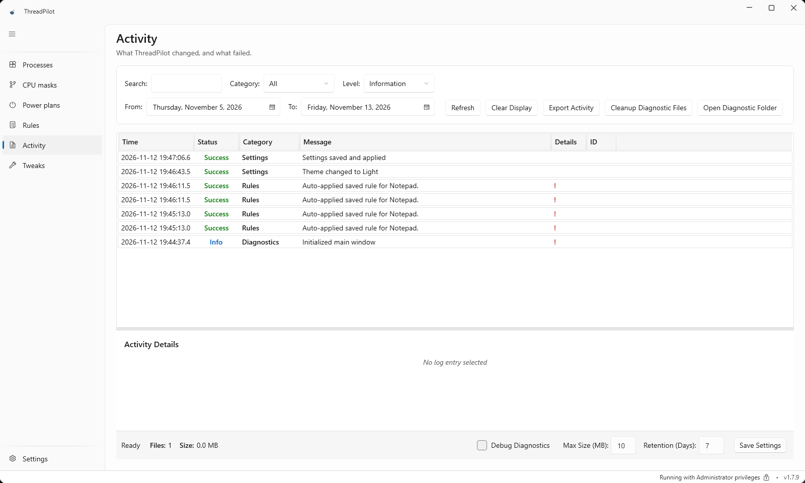
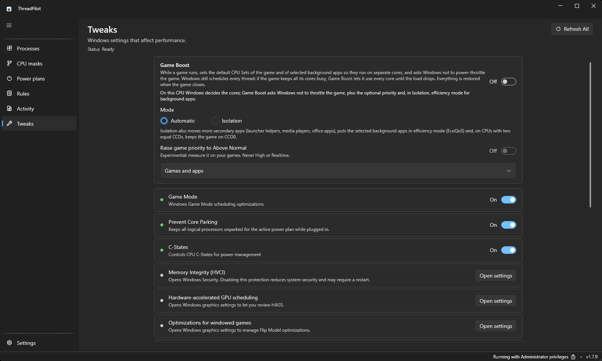
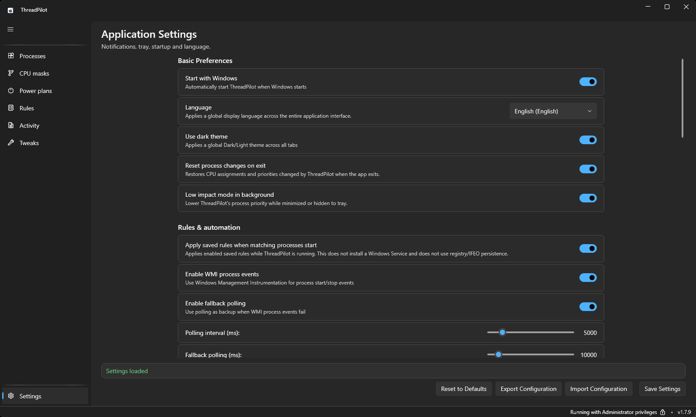

<div align="center">
  
  <h1>ThreadPilot ✈️</h1>
  <p><strong>Free, open-source CPU scheduling control for Windows 11: CPU Sets, priorities and saved rules, with no limits or nags.</strong><br>Built for the CPUs where scheduling matters: Intel hybrid and AMD X3D / multi-CCD.</p>
  <p>
    <a href="https://github.com/PrimeBuild-pc/ThreadPilot/commits/main"></a>
    <a href="https://github.com/PrimeBuild-pc/ThreadPilot/stargazers"></a>
    <a href="https://github.com/PrimeBuild-pc/ThreadPilot/issues"></a>
  </p>
  <p>
    <a href="https://github.com/PrimeBuild-pc/ThreadPilot/actions/workflows/ci-devsecops.yml"></a>
    <a href="https://app.codecov.io/gh/PrimeBuild-pc/ThreadPilot"></a>
    <a href="https://github.com/PrimeBuild-pc/ThreadPilot/releases/latest"></a>
    <a href="https://github.com/PrimeBuild-pc/ThreadPilot/releases"></a>
    <a href="https://github.com/microsoft/winget-pkgs/tree/master/manifests/p/PrimeBuild/ThreadPilot"></a>
    <a href="https://community.chocolatey.org/packages/threadpilot"></a>
  </p>
  <p>
    
    
    <a href="Locales/"></a>
    <a href="LICENSE"></a>
  </p>
  <p><a href="#-install">Install</a> · <a href="#-features">Features</a> · <a href="#-how-it-compares">How it compares</a> · <a href="#-screenshots">Screenshots</a> · <a href="#-faq">FAQ</a> · <a href="#-build-from-source">Build</a> · <a href="#-support-the-project">Support</a></p>

</div>

<p align="center"><a href="assets/screenshots/overview-themes.png"></a></p>

<p align="center"><sub>ThreadPilot v1.7.9, real screenshot in dark and light themes. More in the <a href="#-screenshots">gallery</a>.</sub></p>

## What is ThreadPilot?

ThreadPilot is a modern Windows process control center for users who want predictable control over process behavior, CPU affinity, CPU Sets, priority, memory priority, power plans, and saved process rules.

It is designed as an open-source alternative for power users who need Process Lasso-style capabilities, automation support, system tray controls, and a Windows 11-first experience. ThreadPilot is not a performance overlay: its primary job is applying explicit process controls safely and making the result visible.

## ⚖️ How it compares

ThreadPilot started as an open-source alternative to [Process Lasso](https://bitsum.com/). Here is the honest version of how they differ. Check each product's own site for its current features and pricing.

**What ThreadPilot does**

- Open source (AGPL-3.0) and free, with no feature limits and no nag screens. The code is here, so you can check.
- CPU Sets support and topology-aware core selection, including processor groups and more than 64 logical processors; Intel hybrid handling comes from Windows topology (`EfficiencyClass`), not hardcoded CPU lists.
- Saved rules are shown in an editor you can read, and every change lands in an Activity log with filters and export.
- Windows 11 Fluent interface, seven UI languages, plus a Tweaks page for a few basic Windows performance settings.
- No telemetry ([`PRIVACY.md`](docs/PRIVACY.md)). Updated through WinGet and Chocolatey.

**What it does not do (yet)**

- It applies the rules you set. It has no automatic responsiveness management like Process Lasso's ProBalance.
- Saved rules apply only while ThreadPilot is running: no Windows service, no registry or IFEO persistence.
- Windows 11 only (build 22000 or newer), and it always asks for administrator rights.
- Releases are unsigned for now, so SmartScreen may warn ([details](#-faq)).
- Game Boost is still unvalidated on real dual-CCD Ryzen and Intel hybrid CPUs.
- Process Lasso is the older, more established tool with a much longer track record. ThreadPilot is younger and moves fast.

## ✨ Features

- Live process management with refresh, filtering, context-menu actions, and a selected-process summary.
- Topology-aware CPU affinity through `CpuSelection`, including CPU Sets support, processor groups, and safe handling for systems with more than 64 logical processors.
- Safer CPU indexing in new affinity paths: CPU64 no longer aliases CPU0.
- Intel hybrid CPU handling through Windows topology and `EfficiencyClass`, not hardcoded SKU lists.
- Reusable CPU mask presets and custom core selections for process and rule workflows.
- Three-state efficiency mode / EcoQoS for running processes and persistent rules, independently of CPU priority.
- Opt-in Game Boost (off by default) with topology-aware game/background CPU Sets, optional priority and restoration. Real dual-CCD Ryzen/X3D and supported Intel hybrid validation is still pending.
- CPU priority controls with guardrails: High priority warning and Realtime priority blocked.
- Process memory priority support.
- Persistent process rules with explicit Apply now and Save as rule flows.
- Apply saved rules automatically when matching processes start while ThreadPilot is running.
- Rule-based automation for power plan switching when selected processes start or stop.
- Optional Diagnostics view, hidden by default, plus tray controls and dashboard views.
- Administrator-aware Windows desktop workflow.
- CI-backed build validation and package-manager distribution.
- Windows 11 native visual refresh with neutral Fluent surfaces and refined card-based layouts.

## 📦 Install

### Install with WinGet

ThreadPilot is available on WinGet as `PrimeBuild.ThreadPilot`.

From **Command Prompt** or **PowerShell**:

```cmd
winget install --id PrimeBuild.ThreadPilot -e
```

To refresh your local WinGet source first:

```cmd
winget source update
winget search ThreadPilot
```

### Install with Chocolatey

Install ThreadPilot from Chocolatey Community:

```powershell
choco install threadpilot
```

Upgrade an existing installation:

```powershell
choco upgrade threadpilot
```

### Download from GitHub Releases

[](https://github.com/PrimeBuild-pc/ThreadPilot/releases/latest)
**Stable releases include Game Boost** (off by default). It is not yet validated on real dual-CCD Ryzen and Intel hybrid CPUs; if you have one, see the [test steps and issue-reporting checklist](docs/releases/v1.7.8.md#help-us-test-dual-ccd-ryzen-and-intel-hybrid).

Both channels use the same application/settings location. Export a configuration backup before switching; they are not separate side-by-side installations.

| Package | Recommended use |
|---|---|
| `ThreadPilot_v<version>_Setup.exe` | Standard Windows installer for most users |
| `ThreadPilot_v<version>_Portable.zip` | Portable/no-install deployment |

Optional checksum verification:

```powershell
Get-FileHash .\ThreadPilot_v<version>_Setup.exe -Algorithm SHA256
Get-FileHash .\ThreadPilot_v<version>_Portable.zip -Algorithm SHA256
```

Compare the result with `SHA256SUMS.txt` from the same release.

## 🖼️ Screenshots

Real captures of ThreadPilot v1.7.9 (see [`assets/screenshots/README.md`](assets/screenshots/README.md)). They show the interface, not benchmarks. Click a thumbnail for the full-size image.

<table>
  <tr>
    <td align="center" width="33%"><a href="docs/media/threadpilot-demo.gif"></a><br><sub>Demo</sub></td>
    <td align="center" width="33%"><a href="assets/screenshots/processes-dark.png"></a><br><sub>Processes · Dark</sub></td>
    <td align="center" width="33%"><a href="assets/screenshots/processes-light.png"></a><br><sub>Processes · Light</sub></td>
  </tr>
  <tr>
    <td align="center" width="33%"><a href="assets/screenshots/cpu-masks-light.png"></a><br><sub>CPU masks</sub></td>
    <td align="center" width="33%"><a href="assets/screenshots/rules-dark.png"></a><br><sub>Rules</sub></td>
    <td align="center" width="33%"><a href="assets/screenshots/power-plans-light.png"></a><br><sub>Power plans</sub></td>
  </tr>
  <tr>
    <td align="center" width="33%"><a href="assets/screenshots/activity-light.png"></a><br><sub>Activity</sub></td>
    <td align="center" width="33%"><a href="assets/screenshots/game-boost-dark.png"></a><br><sub>Game Boost · off by default</sub></td>
    <td align="center" width="33%"><a href="assets/screenshots/settings-dark.png"></a><br><sub>Settings</sub></td>
  </tr>
</table>

## ❓ FAQ

<details>
<summary><strong>Windows SmartScreen warns me when I run the installer. Is it safe?</strong></summary>

Releases are currently unsigned, so SmartScreen may warn on first launch. A free code-signing application with SignPath Foundation is pending. Until then, compare the file's SHA-256 with `SHA256SUMS.txt` on the same release page (commands in [Install](#download-from-github-releases)), and only then use **More info → Run anyway**. The code is public and CI builds the releases. See [`docs/TROUBLESHOOTING.md`](docs/TROUBLESHOOTING.md).
</details>

<details>
<summary><strong>Why does it need administrator rights?</strong></summary>

The app manifest requests elevation so ThreadPilot can change settings of other processes. If you decline the UAC prompt, the app exits instead of running in a limited mode.
</details>

<details>
<summary><strong>Will it get me banned by an anti-cheat?</strong></summary>

ThreadPilot uses standard Windows APIs (CPU Sets, priority, EcoQoS) and does not inject into other processes. It does not bypass anti-cheat or protected-process restrictions, and we have not tested it against specific anti-cheat systems. If a game's rules forbid touching its process, leave that game alone: the Game Boost feature is off by default for this reason too.
</details>

<details>
<summary><strong>How do I undo a change?</strong></summary>

- **A process change:** on the Processes page, use **Undo last change**.
- **A saved rule:** disable or delete it on the Rules page.
- **Game Boost:** turn it off in Tweaks. It also restores its changes when the game closes.
- **Everything:** priority, CPU Sets and efficiency mode set on a running process do not survive the process exiting. Use **Settings → Export Configuration** before big changes to keep a backup.
</details>

<details>
<summary><strong>Does it keep working when ThreadPilot is closed?</strong></summary>

No. Saved rules apply only while ThreadPilot is running. It installs no Windows service and writes no registry or IFEO persistence. Use the tray icon and the `--start-minimized` / `--autostart` arguments to keep it in the background.
</details>

<details>
<summary><strong>Does it collect data?</strong></summary>

No analytics or telemetry. See [`docs/PRIVACY.md`](docs/PRIVACY.md).
</details>

## ⚙️ Requirements

- Windows 11, build 22000 or newer.
- Administrator privileges to launch and manage system-level process settings.
- .NET 8 SDK only if you want to build from source.

## 🚀 Usage Notes

ThreadPilot uses an administrator-required manifest and requests elevation at startup. If UAC elevation is declined, the application exits instead of continuing in a limited mode.

Persistent process rules are runtime-based. Apply at process start works only while ThreadPilot is running; it does not install a Windows Service, write registry or IFEO persistence, or use installer privilege tricks.

ThreadPilot does not bypass anti-cheat or protected-process restrictions. Running as administrator may help with normal access-denied cases, but it does not override protected-process or anti-cheat enforcement.

Useful startup arguments:

```text
--start-minimized
--autostart
--test
--smoke-test
```

In `Power Plans > Custom Power Plans`, use `Add .pow File` to import custom power plans directly from the app.

ThreadPilot does not bundle third-party `.pow` files. The Power Plans page can open the community Discord catalog on request; Settings also links to Discord support and GitHub Issues. Existing plans already imported into Windows are not removed by updates.

## 🧱 Build from Source

```powershell
git clone https://github.com/PrimeBuild-pc/ThreadPilot.git
cd ThreadPilot
dotnet restore ThreadPilot_1.sln
dotnet build ThreadPilot_1.sln --configuration Release
dotnet run --project ThreadPilot.csproj --configuration Release
```

Run integrated runtime tests:

```powershell
dotnet run --project ThreadPilot.csproj --configuration Release -- --test
```

Publish a self-contained Windows build:

```powershell
dotnet publish ThreadPilot.csproj --configuration Release --runtime win-x64 --self-contained true
```

Build release artifacts with the project script:

```powershell
./build/build-release.ps1
```

## 🔐 Quality and Security

- CI validates build, formatting, analyzers, vulnerability checks, and secret scanning.
- Security disclosures are handled through private GitHub advisories. See [`docs/SECURITY.md`](docs/SECURITY.md).
- ThreadPilot has no analytics or telemetry. See [`docs/PRIVACY.md`](docs/PRIVACY.md).
- Release signing scope and controls are documented in [`docs/CODE_SIGNING_POLICY.md`](docs/CODE_SIGNING_POLICY.md).
- Free code signing provided by [SignPath.io](https://signpath.io), certificate by [SignPath Foundation](https://signpath.org), once the pending application is approved; current artifacts are unsigned.
- Change history is tracked in [`docs/CHANGELOG.md`](docs/CHANGELOG.md).
- Coverage focuses on business/application code and excludes generated build artifacts.

## 🧭 Project Documentation

- [`docs/README.md`](docs/README.md)
- [`docs/CONTRIBUTING.md`](docs/CONTRIBUTING.md)
- [`docs/CODE_OF_CONDUCT.md`](docs/CODE_OF_CONDUCT.md)
- [`docs/RELEASE_SIGNING.md`](docs/RELEASE_SIGNING.md)
- [`docs/CODE_SIGNING_POLICY.md`](docs/CODE_SIGNING_POLICY.md)
- [`docs/PRIVACY.md`](docs/PRIVACY.md)
- [`docs/release/PACKAGING.md`](docs/release/PACKAGING.md)
- [`docs/TROUBLESHOOTING.md`](docs/TROUBLESHOOTING.md)
- [`docs/adr/`](docs/adr/)
- [`docs/releases/`](docs/releases/)

## 🗺️ Roadmap

- Expand unit and integration coverage for core services.
- Continue async reliability refactoring for long-running monitoring paths.
- Improve accessibility and localization readiness across major views.
- Formalize release signing and distribution hardening.

## 🤝 Contributing

Contributions are welcome. Before opening a pull request, please read [`docs/CONTRIBUTING.md`](docs/CONTRIBUTING.md) and [`docs/CODE_OF_CONDUCT.md`](docs/CODE_OF_CONDUCT.md).

For bugs, feature requests, or packaging issues, open a GitHub issue with reproduction steps and your Windows version.

## 📄 License

ThreadPilot is licensed under the **GNU Affero General Public License v3.0**. See [`LICENSE`](LICENSE).

## 💬 Support the Project

<div align="center">

**Built with care for Windows power users.**

[](https://github.com/PrimeBuild-pc/ThreadPilot/issues)
[](https://github.com/PrimeBuild-pc/ThreadPilot/discussions)
[](https://ko-fi.com/primebuild) [](https://paypal.me/PrimeBuildOfficial?country.x=IT&locale.x=it_IT)

If ThreadPilot is useful to you, consider starring the repository, opening thoughtful issues, sharing feedback, or supporting development with a small donation.

</div>
